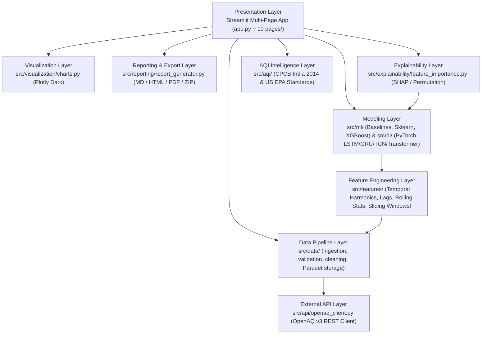

# 🏛️ System Architecture — AeroSense AI

## 1. Architectural Principles
AeroSense AI follows a **decoupled, layered modular architecture** engineered to support:
- **Phase 1 (India-first)** empirical deployment (`IN` / PM2.5 default) and **Phase 2 (Global expansion)** without rewriting core ingestion, modeling, or UI pipelines.
- **Reproducible Data Engineering** with explicit provenance columns (`source_provider`, `api_endpoint`, `retrieved_at`) and immutable Apache Parquet storage.
- **Leakage-Free Forecasting** enforcing strict chronological time-series partitioning.
- **Separation of Concerns** separating API clients, data validation/cleaning, feature synthesis, AQI calculators, ML/DL models, explainability, reporting, and Streamlit presentation.

---

## 2. Layered Component Diagram

---

## 3. Detailed Module Breakdown

### 3.1 Configuration & Utilities (`src/config/`, `src/utils/`)
- **`settings.py`**: Centralizes path resolution (`PROJECT_ROOT`, `DATA_DIR`, `RAW_DIR`, `PROCESSED_DIR`, `FEATURES_DIR`, `EXPORTS_DIR`, `ML_MODELS_DIR`, `DL_MODELS_DIR`, `LOGS_DIR`), OpenAQ v3 parameters, default country (`IN`) and pollutant (`pm25`), and chronological split ratios (`TRAIN_RATIO = 0.70`, `VAL_RATIO = 0.15`).
- **`logging_config.py` & `helpers.py`**: Rotating file and stream logging (`logs/`) plus UTC timestamp helpers.

### 3.2 External API Client (`src/api/openaq_client.py`)
- Implements `OpenAQClient` targeting `https://api.openaq.org/v3` with `X-API-Key` header authentication.
- Automatic exponential-backoff retries on `429` rate limits, `5xx` server errors, and transient network timeouts.
- Safe pagination (`_paginate`) handling OpenAQ v3 integer and string `meta.found` (e.g., `">1000"`).
- Uses `/v3/locations` (`iso`, `parameters_id`), `/v3/locations/{id}/sensors`, `/v3/sensors/{id}/hours`, and `/v3/sensors/{id}/measurements` with `datetime_from` / `datetime_to`.

### 3.3 Data Pipeline (`src/data/`)
- **`ingestion.py`**: Orchestrates location discovery (`fetch_locations`), sensor-level time-series extraction (`fetch_measurements`), provenance tagging, and raw Parquet snapshots.
- **`validation.py`**: Enforces required columns (`value`, `datetime_utc`, `parameter`, `location_id`), UTC parsing, physical range thresholds (`PARAM_RANGES`), and deduplication, returning a structured `ValidationReport`.
- **`cleaning.py`**: Applies per-station/parameter IQR $\times 3$ outlier filtering, hourly resampling, bounded temporal gap interpolation (`max_gap_hours = 6`) with `is_imputed` tracking, and `ppb`/`ppm` to $\mu g/m^3$ unit normalization.
- **`storage.py`**: Manages Apache Parquet I/O and timestamped CSV exports.

### 3.4 AQI Engine (`src/aqi/`)
- **`cpcb.py`**: Indian CPCB National AQI (2014) breakpoints for `pm25`, `pm10`, `no2`, `so2`, `co`, `o3`, and `nh3`.
- **`us_epa.py`**: US EPA Revised AQI (2012/2018 TAD) breakpoints.
- Both calculate per-pollutant sub-indices, identify the dominant pollutant, report category & color, and surface `is_complete` + `missing_pollutants` flags so partial estimates are never misrepresented as official full-panel indices.

### 3.5 Feature Store & Modeling (`src/features/`, `src/ml/`, `src/dl/`)
- **`feature_engineering.py`**: Generates cyclical harmonics (`hour_sin/cos`, `month_sin/cos`, `dow_sin/cos`), seasonal indicators, autoregressive lags (`lag_1`, `lag_3`, `lag_6`, `lag_12`, `lag_24`), rolling statistics (`3, 6, 12, 24`h mean/std/min/max), and `trend_24`.
- **`sequence_builder.py`**: Generates `(N, lookback, 1)` and `(N, horizon)` PyTorch arrays and performs chronological splits without shuffling across temporal boundaries.
- **`src/ml/`**: Evaluates naive baselines (`Persistence`, `Historical Mean`, `Seasonal Naive`) alongside `LinearRegression`, `Ridge`, `RandomForest`, `ExtraTrees`, `HistGradientBoosting`, and `XGBoost`, persisting `.pkl` models with embedded validation/test metrics and CSV leaderboards.
- **`src/dl/`**: Trains PyTorch `LSTMForecaster`, `GRUForecaster`, `TCNForecaster`, and `TransformerForecaster` with gradient norm clipping, `ReduceLROnPlateau`, early stopping, and `.pt` checkpoints.
