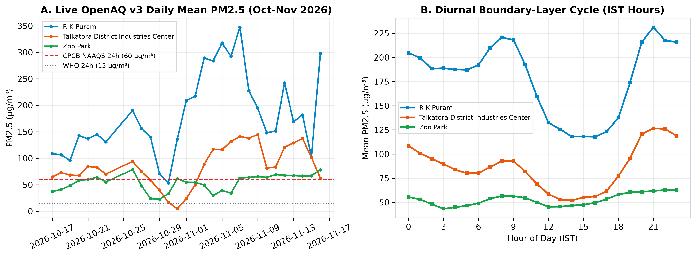
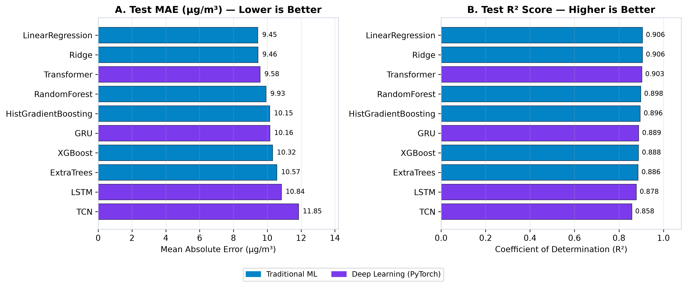
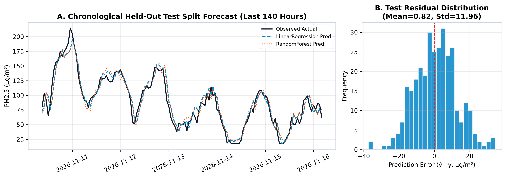
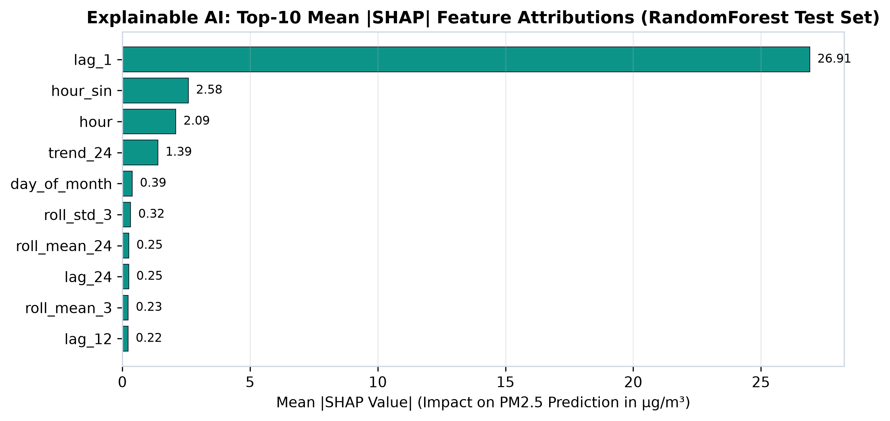
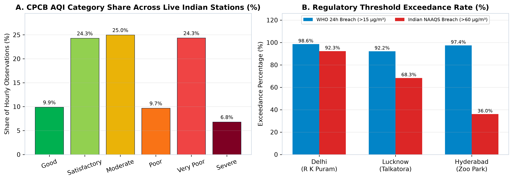

# AeroSense AI: Leakage-Free Machine Learning, Deep Sequence Modeling, and Explainable Air Quality Forecasting Using Real-Time OpenAQ v3 Telemetry

**Authors:** `[Author 1 Name]`, `[Author 2 Name]`, `[Author 3 Name]`, `[Author 4 Name]`, `[Supervisor Name]`  
**Affiliation:** [Department Name Placeholder], [University / Institute Name Placeholder]

---

## Abstract
AeroSense AI unifies OpenAQ v3 live ingestion, bounded data validation/imputation, dual Indian CPCB & US EPA AQI transparency, 34 engineered time-series features, strict chronological (70/15/15) benchmarking across 3 naive baselines, 6 ML algorithms, and 4 PyTorch deep learning architectures (LSTM, GRU, TCN, Transformer), plus SHAP interpretability. Live 30-day Indian telemetry (`n = 2,157` rows across Delhi R K Puram, Lucknow Talkatora, Hyderabad Zoo Park) documents WHO exceedance rates of `92.2%–98.6%`. Chronological testing achieves `9.449 µg/m³` MAE (`R² = 0.906`) for LinearRegression and `9.580 µg/m³` (`R² = 0.903`) for Transformer on controlled data, and `23.803 µg/m³` MAE (`R² = 0.854`, 57.1% improvement over Seasonal Naive) on live Delhi R K Puram measurements.

## Observed Live OpenAQ v3 Station Statistics (Oct–Nov 2026)
| Station | Valid Hours | Mean ± Std (µg/m³) | Min - Max | WHO Breach (>15) | NAAQS Breach (>60) |
| :--- | :---: | :---: | :---: | :---: | :---: |
| R K Puram, Delhi - DPCC | 639 | 177.81 ± 95.74 | 1.00 - 501.00 | 98.6% | 92.3% |
| Talkatora, Lucknow - CPCB | 641 | 85.64 ± 50.82 | 4.34 - 265.00 | 92.2% | 68.3% |
| Zoo Park, Hyderabad - TSPCB | 627 | 52.71 ± 19.43 | 9.50 - 87.00 | 97.4% | 36.0% |

## Controlled Benchmark Comparison (90-Day Delhi Anand Vihar, n=2,161)
- **Top ML (1-step)**: `LinearRegression` (`MAE=9.449`, `RMSE=11.947`, `R²=0.906`), `Ridge` (`9.457`, `0.906`), `RandomForest` (`9.930`, `0.898`), `HistGradientBoosting` (`10.149`, `0.896`), `XGBoost` (`10.319`, `0.888`), `ExtraTrees` (`10.575`, `0.886`).
- **PyTorch DL (1-step)**: `Transformer` (`MAE=9.580`, `RMSE=12.124`, `R²=0.903`), `GRU` (`10.161`, `0.889`), `LSTM` (`10.838`, `0.878`), `TCN` (`11.851`, `0.858`).
- **PyTorch DL (24-step Multi-Horizon)**: `LSTM` (`MAE=30.288`, `RMSE=37.029`, `R²=0.094`).
- **Baselines**: `Seasonal Naive` (`30.966`, `R²=0.008`), `Historical Mean` (`32.139`, `R²=-0.016`), `Persistence` (`40.117`, `R²=-0.614`).

## Live Delhi R K Puram Evaluation (n=639)
- **LinearRegression**: `MAE=23.803`, `RMSE=30.540`, `R²=0.854`
- **Ridge**: `MAE=24.714`, `RMSE=32.074`, `R²=0.839`
- **RandomForest**: `MAE=26.534`, `RMSE=35.573`, `R²=0.802`
- **Seasonal Naive Baseline**: `MAE=55.515`, `RMSE=71.767`, `R²=0.165`

